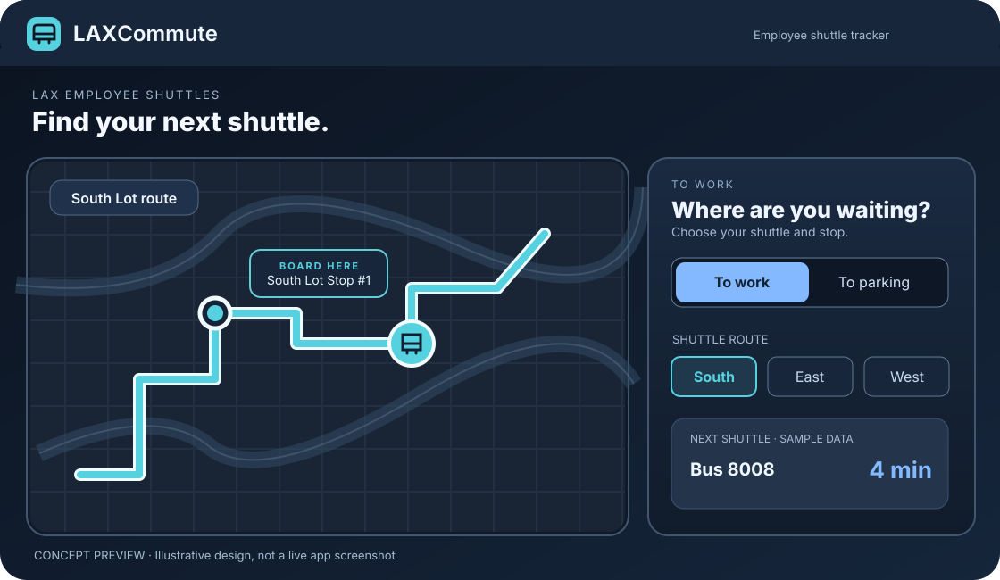

# LAXCommute

**Your airport. Your commute.** A free, installable web app for checking LAX employee shuttle arrivals and planning your trip between the terminals and employee parking lots.

**[Open LAXCommute](https://employeeshuttlelax.com)** · [Report an issue](https://github.com/normanlinn/LAXCommute/issues)



*Design mockup for illustration only — not a screenshot of the deployed app. Vehicle positions and arrival times shown are examples.*

## Features

- **Live shuttle tracking:** South, East and West lot routes, reported bus locations and arrival predictions.
- **Your commute:** choose a direction, boarding stop and usual terminal; save preferences as a guest or with an account.
- **Interactive maps:** selectable stops, route lines, dark mode, and directions via Apple Maps or Google Maps.
- **Made for phones:** install as a PWA, use English / Spanish / Burmese, and see clearly labeled saved data when offline.

> Independent project; **not an official LAWA or airline service**. Predictions and GPS positions come from the existing LAX tracker and may be delayed. A nearby bus does not guarantee boarding.

## Local development

Requires **Node.js 22.12+** (Node 24 recommended).

```bash
git clone https://github.com/normanlinn/LAXCommute.git
cd LAXCommute
npm ci
npm run setup
npm run dev
```

Run checks before opening a pull request:

```bash
npm run format:check
npm test
npm run build
```

The public map needs no API key. Keep private keys out of `.env` variables beginning with `VITE_` and never commit secrets.

## Stack and deployment

**React, TypeScript, Vite, Leaflet, MapLibre, Motion, Supabase, and Cloudflare Workers.**

Cloudflare serves the app and its same-origin API; Supabase handles shuttle-data processing and optional account storage. GitHub Pages alone cannot run the shuttle API. The tracker feed is third-party and may change.

For detailed setup, use the maintained guides: [Hosting](docs/HOSTING.md) · [Backend](docs/SUPABASE-BACKEND.md) · [Accounts](docs/AUTH.md) · [Security](docs/SECURITY.md) · [Languages](docs/LANGUAGE.md).

© LAXCommute contributors.
